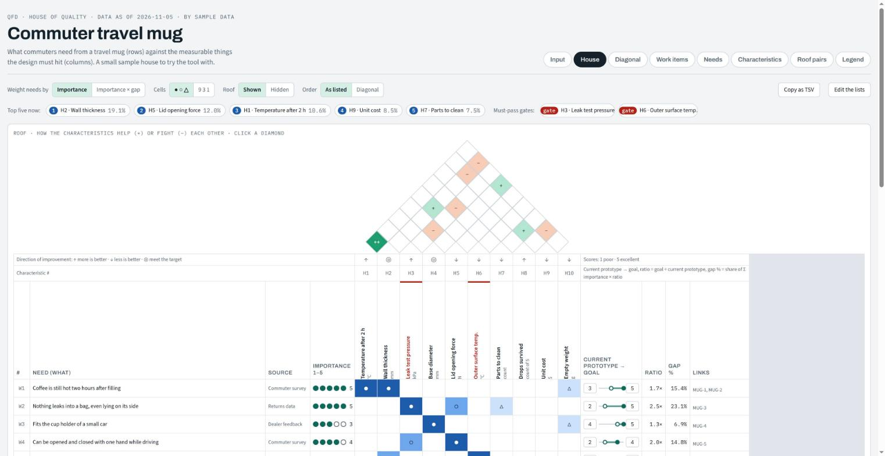
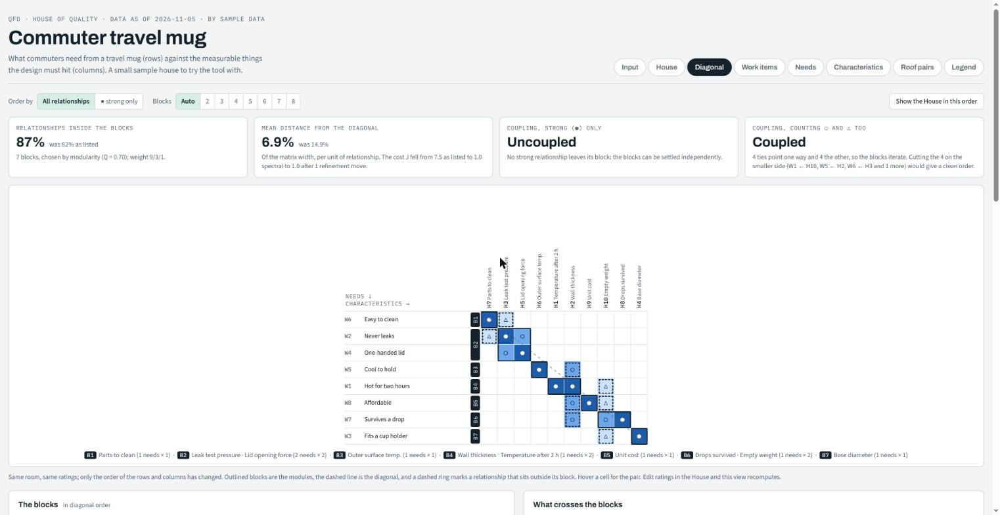
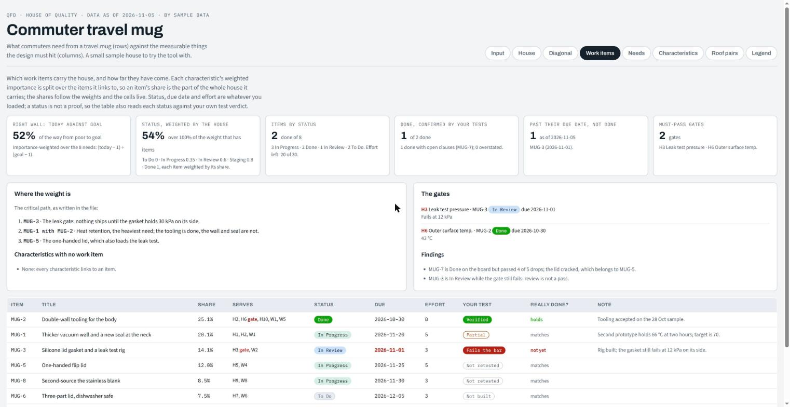
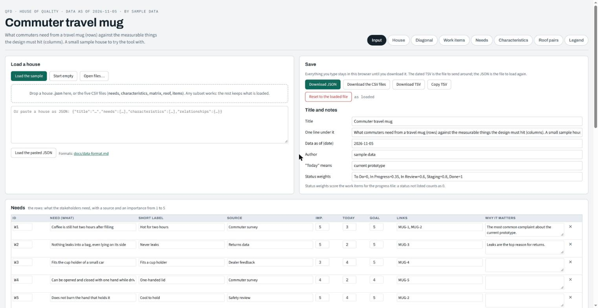
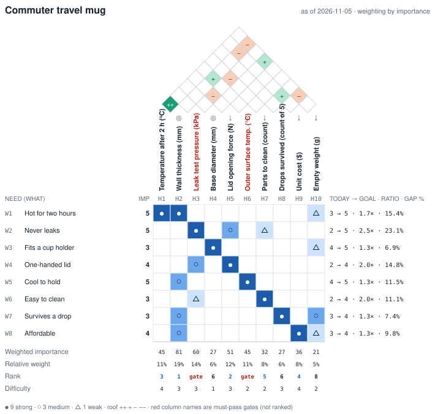

# House of Quality

An interactive House of Quality (the first QFD matrix) with every formula written down, a diagonalised view that finds the modules and couplings in a design, a Daily screen that reads the tracker's statuses against your own tests (what blocks go-live, what to do next, where the tracker is wrong, what is overdue), a spreadsheet generator with live formulas, **and an MCP server, so an AI agent can build, fill, read and export the house through tools.**

Three ways in:

| | |
|---|---|
| **A person** | opens `web/index.html`. Nothing to install: the sample loads, Daily shows the board against the tests in plain words, Planning holds the House in the QFD words, the Input tab takes your JSON or CSV, every cell is clickable. |
| **A script** | runs `node tools/hoq.js` for reports, the dated TSV, CSV, SVG and the diagonal order, and `tools/make_xlsx.py` for the Excel workbook. |
| **An AI agent** | connects to `mcp/server.js` over the Model Context Protocol and runs a QFD session with a stakeholder: 30 tools, four resources and a session prompt, on the same code the page runs. What it proposes, a person confirms. |

It was built to run a real product review: sixteen stakeholder needs against twenty measurable characteristics, with gates, tickets and a weekly version of record. This repository is the generic version of that tool, with a small sample house (a commuter travel mug) so you can see every part working before you load your own.

## For AI agents: the MCP server

`mcp/server.js` is a [Model Context Protocol](https://modelcontextprotocol.io) server over stdio. Any MCP client (Claude Code, Claude Desktop, Cursor, or your own script on the SDK) connects to it and gets the whole house as tools. The tools call the same `web/hoq-core.js` the page calls, so an agent and a person editing the page always get the same numbers.

```bash
git clone https://github.com/jerlandson-supernova/house-of-quality && cd house-of-quality && npm install
claude mcp add hoq -- node "$PWD/mcp/server.js" --file ./house.json
```

Then, in Claude Code:

> **You:** Build a House of Quality for our new kettle. Interview me for the needs.
>
> **The agent** calls `house_new`, asks who the stakeholders are, records each need in your words with its source through `need_set`, asks you for the importance of each one (it is not allowed to guess), adds the measurable characteristics with a unit, a direction and a target through `characteristic_set`, proposes each room cell out loud and sets them in one go with `relationships_set_many`, records the trade-offs with `roof_set`, and reads the empty rows and columns back to you from `house_validate`.
>
> **You:** What should we build first?
>
> **The agent** reads `house_priorities` for the top five and the gates, `house_diagonal` for the modules and the build order, and `house_items` once the tickets are in. `house_export` writes the dated TSV, the version of record, and `house_draw` a picture you can paste anywhere.

**The agent suggests, a person confirms.** A room cell or roof pair the agent sets becomes a *proposal*, with the agent's note and evidence. It counts in no weight, rank or share until a person confirms it, on the page (the cell shows a `?` in the House and waits on the Input tab) or through `proposal_confirm` with the person's name, which the server refuses from the agent itself. Confirmed values keep their provenance: who proposed, who confirmed, when, on what evidence. Every accepted change goes to an append-only log next to the file, and the house carries a revision number. `--direct` turns the proposals off for imports and scripts, still with provenance.

**What the agent gets**

| Group | Tools |
|---|---|
| The house | `house_new`, `house_open`, `house_save`, `house_summary`, `house_get`, `house_validate`, `house_log` (file reads and writes stay inside the house's folder unless `--anywhere`) |
| Rows and columns | `need_set`, `need_remove`, `characteristic_set`, `characteristic_remove` |
| The room and the roof | `relationship_set`, `relationships_set_many`, `roof_set` (proposals unless `--direct`) |
| Proposals | `propose`, `proposals_list`, `proposal_confirm`, `proposal_reject`, and `house_next` for the empty cells worth looking at |
| Assist (with `--assist`) | `assist_status`, `assist_suggest`, `assist_members`: a model's suggestions, as proposals only |
| Work items | `item_set`, `item_remove`, `status_scale_set`, and `items_import` to refresh statuses from a tracker export without touching the verdicts |
| Reading | `house_report`, `house_markdown` (the report to hand to a person), `house_priorities`, `house_diagonal`, `house_items` (the daily read: gates, the next step, the board against the tests, overdue), `house_draw` |
| Export | `house_export` as TSV, CSV, JSON, Markdown, SVG or the Excel workbook |

Plus the resources `hoq://house`, `hoq://report`, `hoq://report.md` and `hoq://drawing.svg`, and a `qfd_session` prompt that walks the agent through a session in the right order. With `--file`, every change is saved to that JSON file, so the page can open the same file and the person can keep editing where the agent left off.

**The skill travels with it.** One command puts the agent guide where each client reads it:

```bash
node tools/hoq.js skills install --target all --project .     # or --target claude,cursor
node tools/hoq.js skills list --project .
node tools/hoq.js skills uninstall --project .
```

| Target | Where it lands | `--user` |
|---|---|---|
| `claude` | `.claude/skills/hoq/SKILL.md` | `~/.claude/skills/hoq/SKILL.md` |
| `codex` | `.agents/skills/hoq/SKILL.md` | `~/.agents/skills/hoq/SKILL.md` |
| `cursor` | `.cursor/rules/hoq.mdc` | project only |
| `copilot` | `.github/instructions/hoq.instructions.md` (`applyTo: "**"`) | project only |
| `gemini` | a marked section in `GEMINI.md` | `~/.gemini/GEMINI.md` |
| `agents-md` | a marked section in `AGENTS.md` | project only |

A manifest (`.hoq-skills.json`) records every file and section with its hash. A file you edited afterwards is never overwritten (`--force` does), `uninstall` removes only what still matches what was written and says what it left alone, and `--dry-run` shows the plan. `tools/test-skills.js` exercises all of this.

**Optional assist: a model suggests, a person confirms.** Start the server with `--assist` and it gains three tools. `assist_suggest` asks a model for 9/3/1/0 on the empty cells worth looking at, with a one-line reason each; `assist_members` extracts needs or characteristics from interview notes, a survey or a spec, each with the verbatim excerpt it rests on; `assist_status` says which model and limits are in use. Nothing the model says is written to the house: every suggestion becomes a proposal with the actor `assist:<model>`, and a person confirms or rejects it like any other. It is off by default, bounded (cells per call, request timeout, output ceiling) and reports token usage on every call. Credentials come from `ANTHROPIC_API_KEY` or an `ant auth login` profile; the model is `claude-opus-5-5` unless `HOQ_ASSIST_MODEL` says otherwise; `--assist mock` runs a deterministic stand-in with no key, which is what the tests use.

The rules an agent must keep are in [`docs/agent.md`](docs/agent.md) and in the skill: needs come from stakeholders in their own words, importance is theirs to set, a characteristic has a unit, gates are never ranked, a board status is a claim, and the dated TSV is the version of record. `npm test` builds a house through the server, as proposals and as direct writes, and checks what comes back.

## Screenshots

The House: roof, room, right wall and basement, with the top five and the gates in the strip above it. Click any cell, dot or diamond.



The Diagonal view: the same room reordered so the relationships gather along the diagonal; the blocks are the modules, the dashed cells the couplings, and the tiles give the coupling verdict.



The work-items table, now the lower half of the Daily screen under "All work items"; above it Daily shows what blocks go-live, what to do next, where the tracker is wrong and what is overdue (screenshot to be retaken).



The Input tab: load the sample, open or drop JSON or CSV files, paste JSON, edit the lists in place, download JSON, CSV or the dated TSV.



The same house drawn as SVG by `node tools/hoq.js svg`, which is also what the page's Download SVG, `HOQ.draw()` and the MCP server's `house_draw` produce:



## What you get

| Part | Where | What it does |
|---|---|---|
| The page | `web/index.html` | Two screens. **Daily**: the gates and whether they are clear, what to do next, where the tracker and your tests disagree, what is overdue, and every work item, in plain words. **Planning**: the House, the Diagonal, Needs, Characteristics, Roof pairs, Legend and Input, in the QFD words (a Words select fixes either vocabulary). Click any cell, dot or diamond to change it; weights and ranks follow. |
| The formulas | `web/hoq-core.js` | Every number the page and the workbook show, as pure functions. Node and the browser load the same file. |
| The input screen | Input tab | Load the sample, start empty, open or drop a `.json` or the CSV files, paste JSON, edit the lists in place, download JSON, CSV, SVG or the dated TSV. |
| The MCP server | `mcp/server.js` | Lets an AI agent build, fill, read and export a house through tools: needs, characteristics, cells, roof, items, priorities, diagonal, drawing, export. See `docs/agent.md`. |
| The drawing API | `HOQ.toSVG`, `HOQ.draw` | Draw a house from a JSON object or URL into any element, in the spirit of JSqfd, with an option to hide rows and columns that have no relationship. `web/embed.html` shows it in two lines. |
| The command line | `tools/hoq.js` | Validate a file, print a report or the daily read, write the TSV, convert between JSON and CSV, merge a tracker export, draw the SVG, compute the diagonal order. `tools/jira-pull.js` reads Jira's REST API for the same merge. |
| The workbook | `tools/make_xlsx.py` | The same house as `.xlsx`: roof, room, right wall, basement with live formulas, the Diagonal sheet, roof pairs, legend, lists. |
| The method | `docs/method.md` | How to run a House of Quality from the first interview to the weekly version of record: what we did, step by step. |
| The formulas, explained | `docs/formulas.md` | Each formula, what it means, and its spreadsheet equivalent. |
| The data formats | `docs/data-format.md` | The JSON shape and the five CSV files. |
| The diagonal view | `docs/diagonalization.md` | Why reorder the room, how the order is found, the sources. |

## Quick start

1. Open `web/index.html`. The sample house appears.
2. Click cells in the House: blank → △ 1 → ○ 3 → ● 9. Click the dots to set importance; type today and goal on the right wall; click a roof diamond. The basement, the charts and the Diagonal tab recompute.
3. Go to **Input**. Either edit the needs and characteristics in the tables, or open your own files: a `house.json`, or any of `needs.csv`, `characteristics.csv`, `matrix.csv`, `roof.csv`, `items.csv` (headers in `docs/data-format.md`; `examples/csv/` has a filled set).
4. **Download JSON** to keep the house; **Download TSV** for the dated version of record you send around; **Download the CSV files** to keep it in a repository.

Everything you type stays in your browser's local storage until you download it. The page never sends anything anywhere.

## The command line

```bash
node tools/hoq.js validate examples/sample-house.json     # errors and warnings
node tools/hoq.js report   examples/sample-house.json     # weights, ranks, gates, diagonal order, items, progress
node tools/hoq.js tsv      examples/sample-house.json     # writes sample-house-YYYY-MM-DD.tsv
node tools/hoq.js csv      examples/sample-house.json out/   # the five CSV files
node tools/hoq.js from-csv out/ house.json                # back to one JSON file
```

Add `--gap` to `report` or `tsv` to weight each need by importance × (goal ÷ today) instead of importance alone.

## Keep statuses current

The verdicts in the house are yours; the statuses belong to the tracker, so they should come from it, not from typing. Three ways, all the same merge (`HOQ.importItems`): statuses, due dates, story points, the tracker's update time, priority and sprint are refreshed; `tested`, `retested` and `note` are never touched; only keys a links field names are added (`--add-all` / `add: "all"` to add every row); and the time the export was read becomes `meta.boardRead`, the day "overdue" is judged against.

**On the page.** Export the board from Jira (Issues → Export → CSV; any CSV with an "Issue key" column works) and drop the file on the Daily strip, or use its "Update statuses from a tracker export" button, or drop it on the Input tab. The strip then says where the statuses came from and when; the panels and the table recompute.

**From the command line.**

```bash
node tools/hoq.js import-items house.json jira-export.csv            # dry run: prints key field old → new, what would be added, statuses not in the weights
node tools/hoq.js import-items house.json jira-export.csv --write    # apply; --out other.json writes a copy instead
node tools/hoq.js daily house.json                                   # the daily read as text
```

**From Jira's API.** `tools/jira-pull.js` needs node 18+ and three environment variables; it never prints the token.

```bash
export JIRA_SITE=your-site.atlassian.net JIRA_EMAIL=you@example.com JIRA_API_TOKEN=…   # token: id.atlassian.com → Security → API tokens
node tools/jira-pull.js --house house.json            # dry run: the diff
node tools/jira-pull.js --house house.json --write    # apply, and append items.import to house.log.jsonl
```

By default it asks for the projects the house names (`project in (MUG) ORDER BY key`) rather than `key in (…)`, which Jira refuses as a whole when one key no longer exists; `--jql "…"` overrides it, `--points-field` and `--sprint-field` name the custom fields (defaults `customfield_10016` and `customfield_10020`). The page never sees the credentials: it reads the saved `house.json`.

**From an agent.** `items_import` takes the export's rows or the CSV text, with `dryRun` to see the diff first; `house_items` then returns the gates, the next step, the mismatches and the overdue list. `docs/data-format.md` has the column mapping.

## Draw a house from a JSON file

Two script tags and one call, for a wiki page, a report or a dashboard:

```html
<script src="hoq-core.js"></script>
<div id="hoq"></div>
<script>HOQ.draw('#hoq', 'house.json', { reduce: true });</script>
```

`reduce` hides the rows and columns that take part in no relationship, so a big house reads small; `symbols: false` prints 9 3 1 instead of ● ○ △; `mode: 'gap'` weights by importance × (goal ÷ today). The same option is on the page as "Rows and columns: With relationships only", and on the command line as `node tools/hoq.js svg house.json out.svg --reduce`. Hiding never changes a number: weights, shares and ranks are always computed over the whole house.

## The workbook

```bash
pip install openpyxl
python3 tools/make_xlsx.py examples/sample-house.json sample.xlsx
```

The workbook's inputs are the coloured cells (importance, today, goal, the room, the roof, difficulty); weighted importance, shares, ratios and ranks are formulas, so the sheet recalculates when the inputs change. The Diagonal sheet links every cell to the HoQ sheet and recomputes its measures, but its order and blocks are fixed at generation; re-run the script after large edits. The script runs `node tools/hoq.js diag` for the order; without node it skips that sheet.

## The method in one paragraph

Write down what the stakeholders need, each with its source and an importance from 1 to 5. Write down the measurable characteristics the design must hit, each with a unit, a direction and a target. Rate every pair 9, 3, 1 or blank. Mark the characteristics that help or fight each other in the roof. Score where each need stands today against its goal. Read the basement: which characteristics carry the weight, and which are must-pass gates that should never be traded against features. Reorder the room along its diagonal to see the modules and the couplings between them. Link each characteristic to the work items that will deliver it, and read the board's status against your own tests. Send the dated TSV as the version of record. The long version, with the mistakes we made, is `docs/method.md`.

## Repository layout

```
web/            index.html (the page: Daily and Planning), hoq-core.js (the formulas, the board facts, the tracker merge and the drawing), sample-house.js (the sample, loaded by the page), embed.html (HOQ.draw example)
mcp/            server.js (the MCP server), assist.js (the optional model assist), test-client.js (its test), live-check.js (one real assist call, by hand)
tools/          hoq.js (command line), jira-pull.js (statuses from Jira's REST API), skills.js (the skills installer), make_xlsx.py (workbook), test-core.js and test-skills.js (checks)
skills/         hoq/SKILL.md (the agent skill; `tools/hoq.js skills` installs it)
examples/       sample-house.json, the same house as five CSV files, and tracker-export.csv (a Jira-shaped export of its board)
docs/           method, formulas, data format, diagonalization, agent (the MCP tools and the rules for an agent)
```

The page, the CLI, the drawing and the workbook need nothing installed beyond node (and python with openpyxl for the workbook). Only the MCP server has dependencies: `npm install` fetches the MCP SDK, zod and the Anthropic SDK (used only with `--assist`).

`web/sample-house.js` is generated from `examples/sample-house.json` with `node tools/hoq.js sample-js examples/sample-house.json web/sample-house.js`.

## License

MIT. See `LICENSE`.
